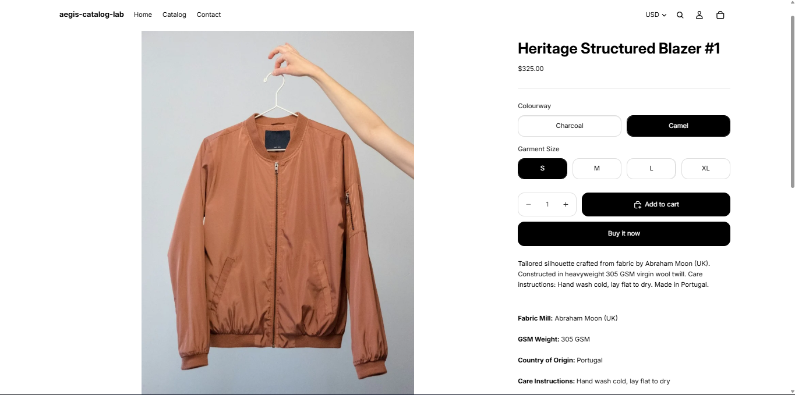
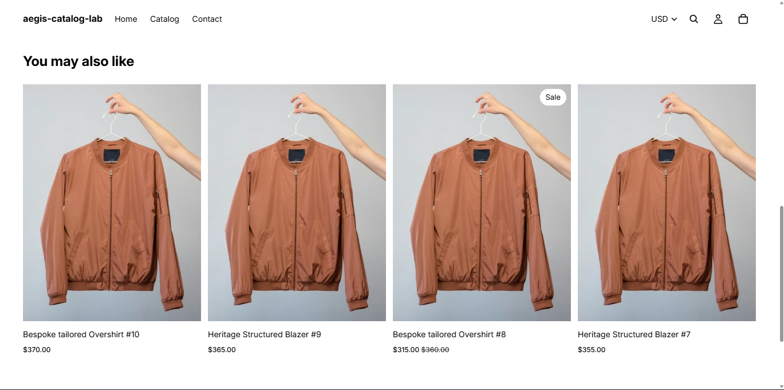
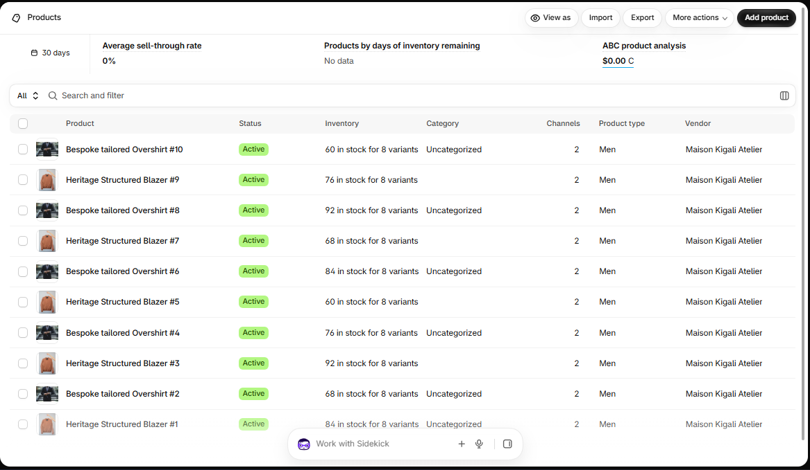
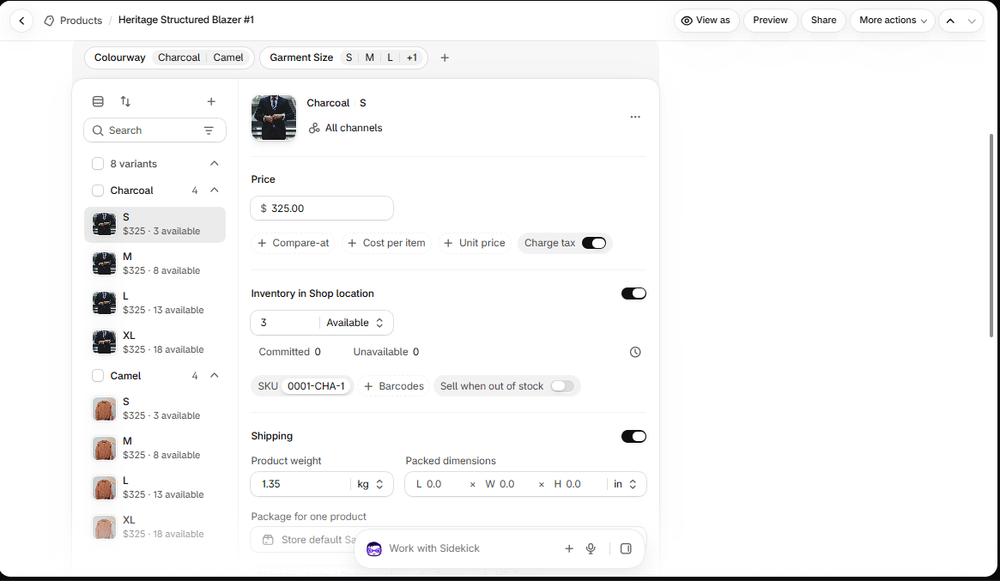
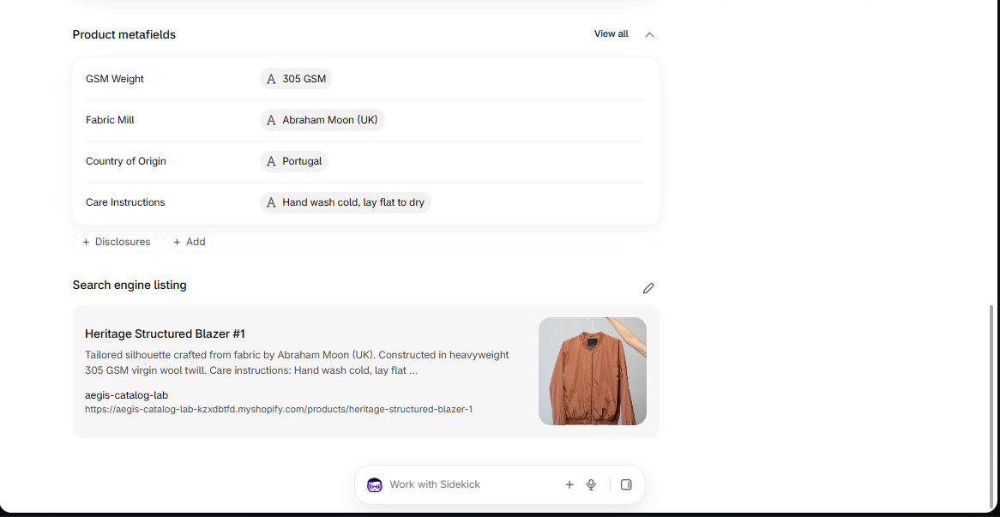

# Automated Shopify Catalog ETL, Matrixify Migration & OS 2.0 Metafield Pipeline

End-to-end catalog normalization, custom metafield extraction, and Matrixify bulk migration validated on a live Shopify Online Store 2.0 storefront (aegis-catalog-lab / **Horizon** theme).

## Architecture & Deliverables
* **Option & Variant Normalization:** Standardized supplier size strings into structured Colourway (Charcoal, Camel) and Garment Size (S, M, L, XL) option trees across 10 parent garments (80 total variants).
* **Deterministic SKU, Weight & Inventory Mapping:** Generated structured SKUs (0001-CHA-1), assigned 1.35 kg shipping weights, calculated compare-at sale pricing ($315.00 vs. $360.00), and mapped inventory (60–92 units per product) across active sales channels.
* **Automated Regex Metafield Extraction:** Parsed unstructured paragraph descriptions into four pinned Shopify custom product metafield definitions (Fabric Mill, GSM Weight, Country of Origin, Care Instructions) and automated SEO handles.
* **Zero-Error Matrixify Import:** Imported all 10 multi-variant products (80 rows) in 1 min 31 sec with zero errors and dynamic source binding on the live product template.

## 1. Live Storefront: Normalized Variants & Dynamic Metafield Specifications

## 2. Live Storefront: Automated Compare-At Sale Pricing

## 3. Shopify Admin: 10-Product Multi-Variant Catalog

## 4. Shopify Admin: Grouped Option Tree, SKUs & Inventory Tracking

## 5. Shopify Admin: Pinned Product Metafields & SEO Handle Preview

